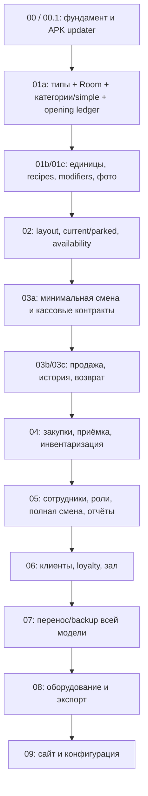

# Порядок построения системы и зависимости

Статус: план реализации, 2026-10-24. Текущая задача — документация; бизнес-код не начинается автоматически. Логические области: [MODULES.md](MODULES.md). Документационные gates: [DOCUMENTATION-PLAN.md](DOCUMENTATION-PLAN.md).

## Критический путь

Стрелки отражают выбранную последовательность приёмки, не все Kotlin imports. Изолированную спецификацию/fake adapter можно готовить раньше, не включая неготовую функцию в продукт. Миграции/простой failure recovery начинаются в 01, не ждут 07. Настройки отображения подключаются по потребности feature, интеграционные настройки сайта — в 09.

## Первый результат: 01a

Начинаем с **категории и простого товара, реально сохранённых в Room**. Не с рисования всех экранов и не с backend.

1. M02: типы ID/revision, BYN для каталога (подтверждено пользователем), decimal/parser, typed errors и commandId.
2. M03: первая Room schema, transaction runner, migration baseline и actual constraints.
3. M10 minimum: opening movement/balance/revision для нового simple, без складской админки.
4. M06 minimum: явный actor single-owner и guard contract, без имитации готовых ролей.
5. M07/M01: category/simple commands → ViewModel → список/поиск/редактор; navigation сохраняет контекст.
6. Проверить rollback/retry/reopen/process recreation, затем APK на планшете. Это завершает выбранные части P01/P02/P03/P10, не весь этап 01.

Подробный schema/validation/UI scope: [FOUNDATION-CONTRACTS.md](FOUNDATION-CONTRACTS.md). Неподтверждённый денежный rounding продаж не препятствует каталогу с явными ограничениями ввода; checkout до его утверждения отсутствует.

## Инкременты и выходные условия

| Инкремент | Что строим | Что должно быть доказано |
|---|---|---|
| 01a | каталог simple/category, Room, opening ledger, owner context | сохранение/поиск/restart, conflict/error, повтор commandId |
| 01b | base/display unit, flags, recipes/yield/cost | units/graph/precision, включая 1/3, отсутствие потери малого расхода |
| 01c | modifiers, photos, dependency deletion guard | P06/P08/P09, file staging/reopen |
| 02a | layout и current cart | persistent lines, canonical merge, rotation, rapid taps |
| 02b/02c | parked transfer/reservations/revalidation, tablet UX | W01–W07 и согласованная доступность |
| 03a | минимальные active shift/open/close/cash boundary | одна активная смена, повтор open/close, sale admission contract |
| 03b | payment policy и atomic sale/history | S01/S02/S04/S05, no false success/duplicate |
| 03c | refund historical allocations, integration update guard | S03, restore stock, installer/commit coordination |
| 04a | suppliers/purchase/partial receiving | документ закупки не меняет stock, один receipt движения |
| 04b | inventory/baseline/history | I01–I04, stale reject/cancel remainder |
| 05 | сотрудники/auth/permissions, полная смена/cash UI, отчёты | H01–H04, sums/role checks/snapshot queries |
| 06a/06b | customer/consent/loyalty и hall/booking | C01–C05, server parts по fake+staging contract |
| 07 | native backup + supported Web import | B01–B05 и fault activation/roundtrip |
| 08 | LAN printer/drawer, report export/Telegram | D01–D05, физическое оборудование |
| 09 | binding, remote orders, menu/photos/availability/tariffs | N01–N06, fake/replay/restart/staging |

## Уточнение зависимости смен

03a — минимальная реализация M13, а не весь этап 05. Вносится в 03 по выявленной зависимости: реальная продажа должна иметь явный shiftId/статус смены. До ролей 05 используется один явно показанный локальный владелец/оператор, не анонимная скрытая смена. Полноценные сотрудники, административный вход, назначения/лимиты и отчёты остаются 05. Конкретные cash/refund formulas закрываются пакетом D02 до 03; до этого эксплуатационная оплата не готова.

## Что можно готовить независимо

После 01a возможно отдельно разрабатывать фото adapter и pure recipe tests. После 03 — чтение отчётов, fixtures закупок/инвентаризации, проектирование прав. Зал и локальные брони 06 не требуют SSE сайта 09. Remote loyalty06 требует минимальный transport/binding contract раньше общего UI сайта 09; shared binding/secret provider выделяется по необходимости, без включения online orders заранее.

Пользовательский перенос Web backup остаётся 07 по выбранному порядку. Если для пилота раньше нужен реальный каталог, решение о раннем ограниченном импорте — отдельное изменение объёма, не скрытая часть 01a. Синтетические данные достаточно для разработки.

## Оценка объёма

21 логическая область, 9 продуктовых этапов после фундамента,8 пакетов углубления документации. Это разбиение работы, не оценка календарного срока. Время реализации/стоимость можно оценить после первого вертикального инкремента по фактической скорости и устройству. Процент готовности по числу документов/модулей не вычисляем.
