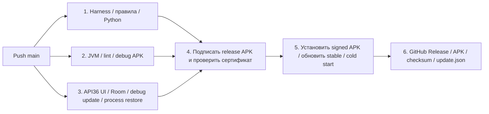

# Локальная разработка в main и выпуск после утверждения

Решения владельца от2026-11-07: работаем в main вместо develop→PR→main; позднейшее уточнение — сначала локальные правки и проверки, push только после утверждения. **Рабочая и основная ветка — main** (в запросах «мастер» означает эту ветку). Новые коммиты в develop не делаем; ветка оставлена как история, не удаляется.

1. Меняем код и документацию локально в main, выполняем подходящие локальные проверки. Эмулятор/данные — только тестовые; физическую приёмку не объявляем по сборке.
2. Показываем владельцу подготовленный результат и проверки. По последнему решению владельца от2026-11-07 push и ручной release workflow выполняем только после его явного утверждения этого набора правок. До утверждения сохраняем изменения локально; не запускаем удалённые прогоны ради каждого небольшого изменения.
3. После утверждения отправляем согласованный набор в remote/main. GitHub Actions запускается на push и проверяет его HEAD; пакетный push нескольких коммитов даёт один прогон для общего результата. Каждый отправленный в main коммит запускает `.github/workflows/android.yml`, включая изменения только документации. Не добавлять `[skip ci]` и не возвращать `paths-ignore`.
4. Прогоны main стоят в очереди, не отменяя друг друга: concurrency `queue: max`, `cancel-in-progress: false`. Внутри каждого прогона независимые группы1–3 идут параллельно.
5. После успешных проверок собирается подписанный APK. Затем проверяется установка/обновление именно этого release APK, и только после этого публикуется GitHub Release и новый stable update.json.
6. При ошибке прогон красный, публикация не выполняется; исправление — новый коммит в main. Физическую/визуальную приёмку не подменяем успехом сборки.

## Что проверяют этапы

1. Структура harness, ledger86окон, release tooling, готовность эмулятора и DAG/доступ к секретам.
2. JVM unit tests, Android lint и debug build.
3. API36 Room/Compose suite, реальное обновление debug APK с финансовыми fixtures и native restore через смену процесса. Bootstrap ждёт sys.boot_completed и устойчивый mCurrentFocus; не отправляет input keyevent82 в launcher без окна. Boot ANR по-прежнему блокирует тесты.
4. Постоянный ключ только в signing job, после всех трёх проверок. Package/version/minSdk/certificate проверяются apksigner/aapt. Создаётся неизменяемый candidate artifact, ещё не релиз.
5. На отдельном одноразовом API36 эмуляторе проверяется SHA/подпись candidate и предыдущего stable, обновление через Android PackageManager, сохранение UID и app-private тестового маркера, открытие настроек и повторный cold start. Это проверка signed APK до публикации, без временного ключа и без user data. Глубокие финансовые данные проверяются debug fixtures этапа3. Если stable ещё нет — проверяется первая установка. Публичный HTTPS updater/permission/Cancel проверяется отдельно вручную через verify-update-channel.yml после опубликованного релиза; это не скрытый пострелизный gate основного pipeline.
6. Только после этапа5: draft с полным набором assets → публикация stable/latest. Проверка versionCode не позволяет откатить канал назад. Установка на планшете требует штатного подтверждения Android.

Общий toolchain — `.github/actions/android-setup/action.yml`. Основной workflow сохраняет имя Android и путь android.yml: run_number участвует в versionCode, сбрасывать счётчик нельзя. Формула и постоянный сертификат прежние.

`workflow_dispatch` на main без publish_release только проверяет/собирает candidate. Для ручного повторного выпуска — publish_release=true. verify_upgrade_from задаёт более ранний baseline для этапа5; пустое значение выбирает latest stable. Для обычного push main публикация автоматическая. Optional PR checks остаются доступными, но PR/develop не являются обязательным рабочим маршрутом. Web-атлас снимается отдельным ручным режимом Android PR workflow с visual_reference=true на main, без APK/release.

Очередь GitHub ограничена100 ожидающими прогонами. Основание: [документация concurrency](https://docs.github.com/en/actions/how-tos/write-workflows/choose-when-workflows-run/control-workflow-concurrency). Это не обещание выпуска при упавших тестах; ошибка любого gate сохраняет прежний stable.
