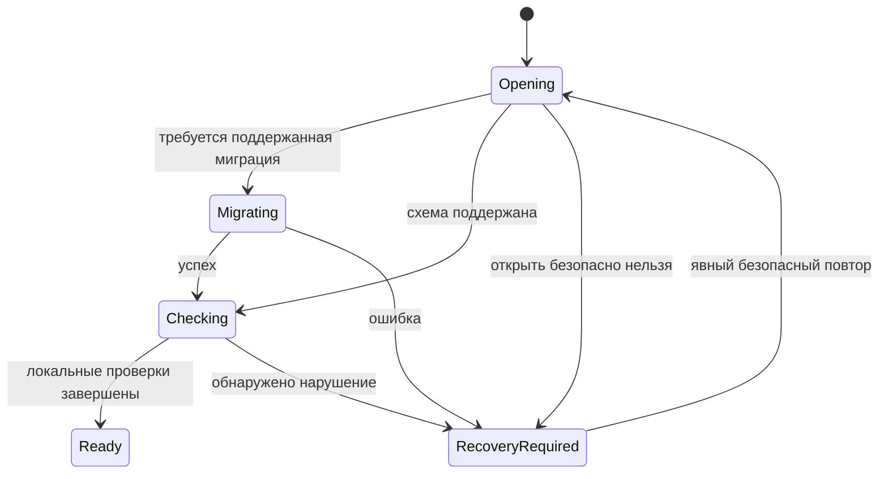

# Состояния и переходы системы

Статус: проектный контракт будущей реализации. Имена состояний условны и не объявляют Kotlin API готовым. Приоритет: [операционные сценарии](OPERATIONS-SPEC.md), [данные](DOMAIN-MODEL.md), [восстановление](RESILIENCE.md). Одно enum не должно смешивать состояние заказа, платежа, печати и сети.

## Запуск приложения

До Ready блокируются предметные записи/фоновые эффекты/installer. RecoveryRequired показывает причину и доступные безопасные действия; если БД не открывается, просмотр данных тоже не обещается. Наличие сети не является условием Ready для локальных функций. Room открывается/мигрируется до выдачи repository; при смене базы на import закрываются старые readers/workers.

## Редактор товара

Сохранённый product и editor draft имеют разные IDs/версии. Clean → Dirty при вводе; Dirty → Saving по кнопке. Успех приводит в Clean с новой revision; Validation/Conflict/StorageFailure возвращают в Dirty с введёнными полями. Закрытие Dirty предлагает сохранить/отбросить/продолжить. Потеря Activity не означает отбросить. Повтор commandId после потерянного UI-ответа возвращает прежний result.

Если права администратора отозваны пока редактор открыт, подтверждение блокируется повторной проверкой в use case. Уже committed изменение не отменяется последующим logout; новый ввод требует новых прав.

## Рабочий заказ: состояние и валидность отдельно

| Переход | Предусловие | Атомарное действие / результат |
|---|---|---|
| EmptyCurrent → Current | valid configured item, доступность | сохранить новую revision сессии |
| Current → Current | expectedRevision, validation | заменить кандидат и reservation projection |
| Current → Parked + EmptyCurrent | непустой заказ/подпись | перенести, не скопировать резерв |
| Parked + EmptyCurrent → Current | parked существует | удалить parked слот и активировать current |
| Parked + NonEmptyCurrent → без изменения | конфликт текущего заказа | предложить отложить current или отменить |
| Current → EmptyCurrent | подтверждение очистки | удалить строки/резерв, согласованно сбросить параметры |
| Parked → Deleted | подтверждение | удалить draft/резерв; не создавать возврат |
| Current → ClosedSale + EmptyCurrent | Sale commit прошёл | receipt/stock/session/outbox в одной transaction |

RevalidationRequired — флаг валидности строк с reference revisions, а не потеря заказа. Изменение каталога/рецепта/доступности не стирает draft. Revalidate показывает разницу и сохраняет принятый вариант; игнорирование/закрытие не снимает флаг. Sale ещё раз проверяет актуальность внутри transaction. В 02 ClosedSale отсутствует: доступен только предварительный расчёт.

## Продажа и внешний платёж

Локальная команда: Requested → Validating → Committing → Committed либо Rejected. Validating/Committing могут быть runtime фазами; durable факт — OperationResult/receipt после commit. Нельзя записать «успех» отдельно до receipt. Отмена coroutine/закрытие Activity около commit требует LookupResult(commandId), а не вывода «операция точно отменена».

У внешнего платежа отдельные статусы: NotStarted / InFlight / Confirmed / Rejected / Unknown. Timeout после отправки не равен Rejected. Пока Unknown не разрешён по контракту эквайринга, повтор списания тем же/новым способом запрещён либо требует явно разработанной процедуры. В текущем объёме интеграция эквайринга не реализована и не подразумевается выбором «Карта».

Sale Committed не возвращается в draft. Ошибка печати/сети меняет соответствующее задание, не receipt. Возврат — отдельная команда и документ, не переход исходной продажи в редактируемую запись. Флаги «частично/полностью возвращён» вычисляются по подтверждённым refund allocations; поддержка partial требует утверждения S04.

## Смена и инвентаризация

Shift: Closed/нет активной → Open → Closed. Закрытие сериализуется с sale/наличными движениями, финальный snapshot включает определённый набор committed операций. Повтор CloseShift возвращает прежний итог. Минимальная смена реализована в03a до продажи (ci-verified API36/run40206673038), её актуальный контракт —SHIFT-03A.md, full управление остаётся05; [план](DELIVERY-ROADMAP.md). Single-owner не подменяется скрытой фиктивной сменой; cash/refund formulas утверждаютсяD02.

Inventory: Draft → Counting → Completed либо CancelledRemainder. Строка Uncounted → Counted(baseline) → Applied(documentId). Из Counted при stale baseline — RequiresRecount, без движения. После restart незавершённый физический подсчёт требует повторного ввода baseline (native перенос Web safety). Applied неизменна; отмена остатка сохраняет applied историю. Повтор applied command не корректирует stock снова.

## Внешние эффекты и заказы сайта

Outbox: Pending → InFlight → Succeeded; транспортная ошибка до доказанной отправки → RetryScheduled; неоднозначная отправка → ReconcileRequired; terminal validation/auth error → Blocked. По restart незавершённый InFlight разбирается по типу транспорта, а не безусловно отправляется заново. Переходы и lease сохраняются локально; обработчики не работают с записью без права владения попыткой.

У remote order отдельно serverStatus, localLink и syncState. Подтверждённый серверный статус не выдумывается по нажатию кнопки. Повтор SSE события не создаёт другой localSession. Связка serverOrderId scoped по bindingId, смена endpoint не перепривязывает старый заказ. Конкретные server states/ревизии остаются контрактной задачей 09.

## APK и guard будущих операций

Текущий updater уже имеет свои check/download/verify/install/restart состояния, см. [UPDATES.md](UPDATES.md). После появления Room разрешение установки должно атомарно согласовываться с coordinator приложения: не только «кнопка disabled», но запрет новой несовместимой записи между последней проверкой guard и запуском installer. Отмена системного installer снимает временный запрет; не объявляется успешным обновлением. После process death старт снова проходит проверку схемы и фактической установленной версии.

## Приёмочные переходы

| Случай | Ожидаемое наблюдение | IDs |
|---|---|---|
| catalog изменён после добавления строки | draft существует, требуется revalidation | W06/S01 |
| receipt записан, Activity уничтожена до результата | lookup находит один receipt, оплата не повторяется | S01/S02 |
| logout после открытия admin формы | сохранение отклонено без изменения БД | H03/H04 |
| sale и CloseShift одновременно | одна согласованная последовательность, без чека за границей закрытия | S01/H01/H02 |
| Applied часть inventory, отмена остатка | движения и история applied остаются | I03 |
| installer запрошен во время commit | переход к установке не происходит | S01/U04 integration |
